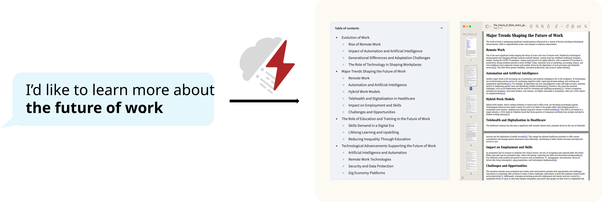
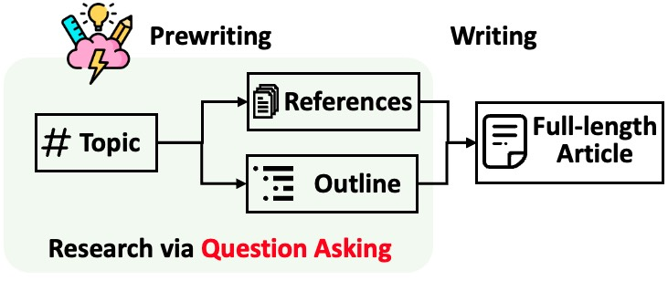
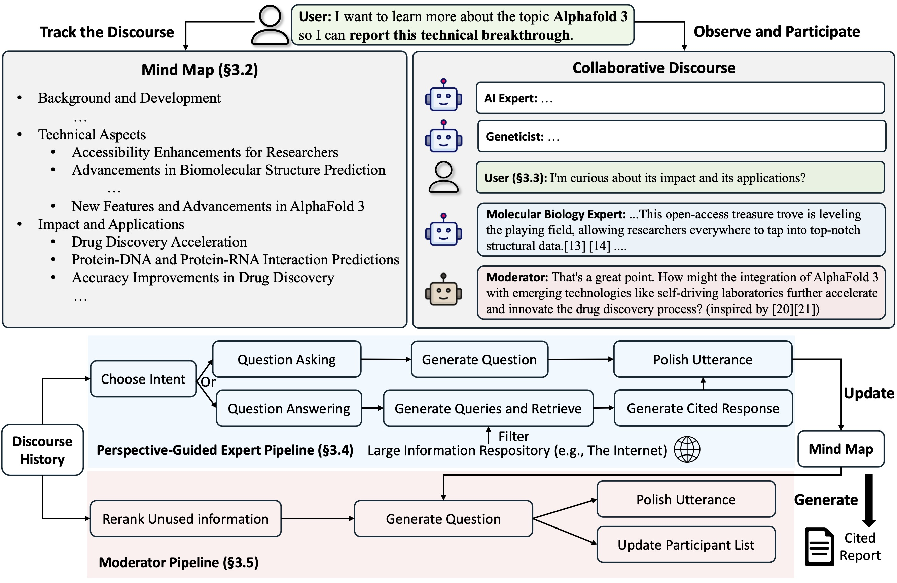

<p align="center">
  
</p>

# STORM: 基于检索与多视角提问的话题大纲合成与长文生成引擎 (Synthesis of Topic Outlines through Retrieval and Multi-perspective Question Asking)

<p align="center">
| <a href="http://storm.genie.stanford.edu"><b>在线研究预览版</b></a> | <a href="https://arxiv.org/abs/2402.14207"><b>STORM 论文</b></a> | <a href="https://www.arxiv.org/abs/2408.15232"><b>Co-STORM 论文</b></a> | <a href="https://storm-project.stanford.edu/"><b>官方主页</b></a> |
</p>

<p align="center">
  <a href="README.md">English</a> · <b>简体中文</b>
</p>

**最新动态** 🔥

- [2025/01] 在 `knowledge-storm` v1.1.0 中为大语言模型和嵌入模型新增 [litellm](https://github.com/BerriAI/litellm) 深度集成。
- [2024/09] Co-STORM 代码库正式发布并整合进 `knowledge-storm` Python 包 v1.0.0。运行 `pip install knowledge-storm --upgrade` 即可体验。
- [2024/09] 推出协同版 STORM (Co-STORM)，支持人机协同知识策展！[Co-STORM 论文](https://www.arxiv.org/abs/2408.15232) 已被 EMNLP 2024 主会接收。
- [2024/07] 支持通过 `pip install knowledge-storm` 一键安装 Python 包！
- [2024/07] 新增 `VectorRM` 向量检索模块，支持基于用户本地自定义文档库进行内容生成与事实溯源，补全了搜索引擎检索（`YouRM`, `BingSearch`）。（详见 PR [#58](https://github.com/stanford-oval/storm/pull/58)）
- [2024/07] 发布面向开发者的轻量 Demo（基于 Python Streamlit 框架构建的极简交互界面），方便本地二次开发与演示部署。（详见 PR [#54](https://github.com/stanford-oval/storm/pull/54)）
- [2024/06] STORM 亮相 NAACL 2024！在 6 月 17 日 Poster Session 2 展出，可参考 [宣讲演示材料 (PDF)](assets/storm_naacl2024_slides.pdf)。
- [2024/05] 在 [rm.py](knowledge_storm/rm.py) 中新增 Bing Search 搜索支持。使用 `GPT-4o` 评测 STORM —— 在线 Demo 中的文章生成模块已接入 `GPT-4o`。
- [2024/04] 发布重构版 STORM 代码库！在 [interface.py](knowledge_storm/interface.py) 中定义了标准流水线接口，并在 [`src/storm_wiki`](knowledge_storm/storm_wiki) 中重新实现了 STORM-wiki，演示流水线实例化。提供开放 API 支持接入各类自定义大语言模型与检索/搜索引擎。

[](https://github.com/psf/black)

## 概述 [(立即体验 STORM 在线预览版!)](https://storm.genie.stanford.edu/)

<p align="center">
  
</p>

STORM 是一个基于互联网搜索、从零自动撰写维基百科式深度长文的大语言模型系统。Co-STORM 则进一步增强了该能力，引入人机协同机制，支持更符合人类意图与偏好的信息检索与知识策展。

虽然系统生成的文章尚不能直接作为无需修改的出版成品，但众多资深维基百科编辑已将其广泛应用于**撰写前的深度信息调研与大纲梳理阶段**。

**已有超过 70,000 名用户体验了我们的 [在线研究预览版](https://storm.genie.stanford.edu/)。欢迎亲自体验 STORM 如何助力您的知识探索之旅，并期待您的宝贵反馈 🙏！**

## STORM 与 Co-STORM 工作原理

### 1. STORM 核心机制

STORM 将包含权威引用的长文生成分解为两大阶段：

1. **写前调研阶段 (Pre-writing stage)**：系统通过互联网搜索收集参考资料，并自动合成结构化层级大纲。
2. **正文撰写阶段 (Writing stage)**：系统依据提纲和收集的参考文献，生成带有逐条事实引用的完整长篇文章。

<p align="center">
  
</p>

STORM 发现自动化调研的核心痛点在于**如何提出高质量、有深度的关键问题**。若直接用 Prompt 要求 LLM 提问，效果往往浮于表面。为此，STORM 创新性地采用两种策略：
1. **多视角引导提问 (Perspective-Guided Question Asking)**：输入主题后，STORM 通过分析同类主题的现有权威文章挖掘不同观察视角，并用这些视角引导提问流程。
2. **模拟专家对话 (Simulated Conversation)**：STORM 模拟维基百科作者与基于互联网信息的多领域专家之间的多轮对话，使大模型能够在对话中不断更新对主题的认知，并持续提出深挖跟进问题。

### 2. Co-STORM 协同机制

Co-STORM 提出了**协同研讨协议 (Collaborative Discourse Protocol)**，通过发言轮次管理策略实现多方高效协作：

- **Co-STORM LLM 领域专家**：基于外部知识源生成可靠回答，并依据研讨历史提出跟进问题。
- **研讨主持人 (Moderator)**：基于检索模块发现但在过往轮次未被充分讨论的增量信息，提出启发性新问题（问题本身亦具备事实支撑）。
- **人类用户**：用户可选择 (1) 旁观对话以快速吸收对该主题的全局认知，或 (2) 主动插话表达意图以引导研讨方向。

<p align="center">
  
</p>

Co-STORM 还维护了一个动态更新的**思维导图 (Mind Map)**，将收集的信息组织为层次化概念网络，构建**人类用户与系统之间的共享概念认知空间**。实验证明，当对话向纵深发展时，思维导图能显著降低人类的心智认知负荷。

STORM 与 Co-STORM 均使用 [dspy](https://github.com/stanfordnlp/dspy) 进行高度模块化开发。

## 安装指南

直接通过 pip 安装 Python 库：
```shell
pip install knowledge-storm
```

若需直接修改 STORM 引擎源码与算子：
1. 克隆代码仓库：
    ```shell
    git clone https://github.com/stanford-oval/storm.git
    cd storm
    ```
2. 创建环境并安装依赖：
    ```shell
    conda create -n storm python=3.11
    conda activate storm
    pip install -r requirements.txt
    ```

## 核心 API 支持矩阵

当前包已支持：
- **大语言模型组件**：支持 LiteLLM 支持的全部模型（参阅 [LiteLLM 模型列表](https://docs.litellm.ai/docs/providers)）
- **Embedding 向量模型**：支持 LiteLLM 支持的全部嵌入模型（参阅 [LiteLLM Embedding 列表](https://docs.litellm.ai/docs/embedding/supported_embedding)）
- **检索/搜索模块**：支持 `YouRM`、`BingSearch`、`VectorRM`、`SerperRM`、`BraveRM`、`SearXNG`、`DuckDuckGoSearchRM`、`TavilySearchRM`、`GoogleSearch` 与 `AzureAISearch`。

🌟 **非常欢迎向 [knowledge_storm/rm.py](knowledge_storm/rm.py) 提交 PR 接入更多搜索引擎与检索后端！**

STORM 与 Co-STORM 运行在知识策展层，您只需分别配置信息检索模块与大语言模型模块即可创建对应的 `Runner`。

### STORM API 实战示例

STORM 知识策展引擎封装为简洁的 `STORMWikiRunner` 类。以下是结合 You.com 搜索引擎与 OpenAI 模型的完整示例：

```python
import os
from knowledge_storm import STORMWikiRunnerArguments, STORMWikiRunner, STORMWikiLMConfigs
from knowledge_storm.lm import LitellmModel
from knowledge_storm.rm import YouRM

lm_configs = STORMWikiLMConfigs()
openai_kwargs = {
    'api_key': os.getenv("OPENAI_API_KEY"),
    'temperature': 1.0,
    'top_p': 0.9,
}

# STORM 采用多模型协同架构，不同组件可灵活配置不同模型以平衡成本与生成质量。
# 实践建议：对话模拟、查询拆解使用轻量快速模型（如 gpt-3.5-turbo / gpt-4o-mini）；
# 最终大纲合成与带引用的正文生成使用更强的高性能模型（如 gpt-4o / claude-3-5-sonnet）。
gpt_35 = LitellmModel(model='gpt-3.5-turbo', max_tokens=500, **openai_kwargs)
gpt_4 = LitellmModel(model='gpt-4o', max_tokens=3000, **openai_kwargs)
lm_configs.set_conv_simulator_lm(gpt_35)
lm_configs.set_question_asker_lm(gpt_35)
lm_configs.set_outline_gen_lm(gpt_4)
lm_configs.set_article_gen_lm(gpt_4)
lm_configs.set_article_polish_lm(gpt_4)

# 更多参数请参考 STORMWikiRunnerArguments 类
engine_args = STORMWikiRunnerArguments(...)
rm = YouRM(ydc_api_key=os.getenv('YDC_API_KEY'), k=engine_args.search_top_k)
runner = STORMWikiRunner(engine_args, lm_configs, rm)
```

启动调研与文章生成流程：
```python
topic = input('Topic: ')
runner.run(
    topic=topic,
    do_research=True,
    do_generate_outline=True,
    do_generate_article=True,
    do_polish_article=True,
)
runner.post_run()
runner.summary()
```
- `do_research`: 为 True 时，模拟多视角对话广泛收集主题信息；否则加载已有缓存结果。
- `do_generate_outline`: 为 True 时，基于调研结果生成层次化提纲。
- `do_generate_article`: 为 True 时，基于提纲与参考文献生成带引用的长篇文章。
- `do_polish_article`: 为 True 时，对文章进行润色（添加摘要部分并可选去重）。

### Co-STORM 协同 API 实战示例

Co-STORM 知识策展引擎封装为 `CoStormRunner` 类。以下是结合 Bing 搜索与 OpenAI 模型的示例：

```python
from knowledge_storm.collaborative_storm.engine import CollaborativeStormLMConfigs, RunnerArgument, CoStormRunner
from knowledge_storm.lm import LitellmModel
from knowledge_storm.logging_wrapper import LoggingWrapper
from knowledge_storm.rm import BingSearch

lm_config: CollaborativeStormLMConfigs = CollaborativeStormLMConfigs()
openai_kwargs = {
    "api_key": os.getenv("OPENAI_API_KEY"),
    "api_provider": "openai",
    "temperature": 1.0,
    "top_p": 0.9,
    "api_base": None,
} 
question_answering_lm = LitellmModel(model="gpt-4o", max_tokens=1000, **openai_kwargs)
discourse_manage_lm = LitellmModel(model="gpt-4o", max_tokens=500, **openai_kwargs)
utterance_polishing_lm = LitellmModel(model="gpt-4o", max_tokens=2000, **openai_kwargs)
warmstart_outline_gen_lm = LitellmModel(model="gpt-4o", max_tokens=500, **openai_kwargs)
question_asking_lm = LitellmModel(model="gpt-4o", max_tokens=300, **openai_kwargs)
knowledge_base_lm = LitellmModel(model="gpt-4o", max_tokens=1000, **openai_kwargs)

lm_config.set_question_answering_lm(question_answering_lm)
lm_config.set_discourse_manage_lm(discourse_manage_lm)
lm_config.set_utterance_polishing_lm(utterance_polishing_lm)
lm_config.set_warmstart_outline_gen_lm(warmstart_outline_gen_lm)
lm_config.set_question_asking_lm(question_asking_lm)
lm_config.set_knowledge_base_lm(knowledge_base_lm)

topic = input('Topic: ')
runner_argument = RunnerArgument(topic=topic, ...)
logging_wrapper = LoggingWrapper(lm_config)
bing_rm = BingSearch(bing_search_api_key=os.environ.get("BING_SEARCH_API_KEY"),
                     k=runner_argument.retrieve_top_k)
costorm_runner = CoStormRunner(lm_config=lm_config,
                               runner_argument=runner_argument,
                               logging_wrapper=logging_wrapper,
                               rm=bing_rm)
```

步进执行多轮研讨交互：
```python
# 预热启动系统，构建用户与 Co-STORM 间的共享概念空间
costorm_runner.warm_start()

# 步进推进协同研讨（可根据需要多次调用）：
# 1. 旁观当前研讨轮次：
conv_turn = costorm_runner.step()
# 2. 插入人类发言以主动引导研讨方向：
costorm_runner.step(user_utterance="你的输入建议/关注方向")

# 基于研讨沉淀知识生成长篇报告
costorm_runner.knowledge_base.reorganize()
article = costorm_runner.generate_report()
print(article)
```

## 快速上手示例脚本

在 [examples 目录](examples) 中提供了开箱即用的运行脚本。建议在根目录下创建 `secrets.toml` 配置 API 密钥：

```toml
# ============ 大语言模型配置 ============ 
OPENAI_API_KEY="your_openai_api_key"
OPENAI_API_TYPE="openai"

# 若使用 Azure OpenAI 服务：
# OPENAI_API_TYPE="azure"
# AZURE_API_BASE="your_azure_api_base_url"
# AZURE_API_VERSION="your_azure_api_version"

# ============ 检索与搜索引擎配置 ============ 
BING_SEARCH_API_KEY="your_bing_search_api_key"

# ============ 编码器配置 ============ 
ENCODER_API_TYPE="openai"
```

### 运行 STORM 示例
```bash
python examples/storm_examples/run_storm_wiki_gpt.py \
    --output-dir $OUTPUT_DIR \
    --retriever bing \
    --do-research \
    --do-generate-outline \
    --do-generate-article \
    --do-polish-article
```
如需使用自定义大模型或基于自有语料库，请参考 [examples/storm_examples/README.md](examples/storm_examples/README.md)。

### 运行 Co-STORM 示例
```bash
python examples/costorm_examples/run_costorm_gpt.py \
    --output-dir $OUTPUT_DIR \
    --retriever bing
```

## 模块化定制扩展

### STORM 自定义扩展
STORM 引擎包含四大核心模块：
1. **知识策展模块 (Knowledge Curation)**：广泛收集输入主题的相关事实与参考文献。
2. **大纲生成模块 (Outline Generation)**：基于策展知识生成层次化提纲。
3. **文章生成模块 (Article Generation)**：将信息填充进大纲段落并生成精准引用。
4. **文章润色模块 (Article Polishing)**：修饰润色长文以获得更佳的可读性。

标准接口定义在 `knowledge_storm/interface.py`，具体实现在 `knowledge_storm/storm_wiki/modules/*` 中，支持按需定制替换。

### Co-STORM 自定义扩展
1. **多智能体策略定制**：智能体接口位于 `knowledge_storm/interface.py`，实现在 `knowledge_storm/collaborative_storm/modules/co_storm_agents.py`。
2. **轮次管理协议**：通过 `knowledge_storm/collaborative_storm/engine.py` 中的 `DiscourseManager` 实现发言轮次管理，支持定制流转逻辑。

## 开源数据集发布

### FreshWiki
收录了 2022 年 2 月至 2023 年 9 月维基百科编辑最频繁的高质量条目集合。详见 [STORM 论文](https://arxiv.org/abs/2402.14207) 第 2.1 节。可在 [Hugging Face 数据集库](https://huggingface.co/datasets/EchoShao8899/FreshWiki) 直接下载。

### WildSeek
收录自真实网络用户在深度信息调研中的意图与主题对。详见 [Co-STORM 论文](https://www.arxiv.org/abs/2408.15232) 第 2.2 节。可在 [Hugging Face WildSeek 库](https://huggingface.co/datasets/YuchengJiang/WildSeek) 获取。

## 路线图与社区贡献

团队正在积极推进以下方向：
1. **Human-in-the-Loop 交互深化**：进一步增强人类在知识策展全过程中的深度交互与引导。
2. **多模态与多元呈现**：探索超越传统维基百科长文的知识呈现与可视化形式。

如有任何建议或疑问，欢迎提交 Issue 或 Pull Request！
联系人：[Yijia Shao](mailto:shaoyj@stanford.edu) 与 [Yucheng Jiang](mailto:yuchengj@stanford.edu)。

## 致谢 (Acknowledgements)
- 感谢维基百科优质的开源内容。FreshWiki 数据集源自维基百科，遵循 CC BY-SA 许可。
- 感谢 [Michelle Lam](https://michelle123lam.github.io/) 为项目设计 Logo，感谢 [Dekun Ma](https://dekun.me) 主导前端 UI 开发。
- 感谢 Vercel 对开源部署的支持。

## 论文引用

```bibtex
@inproceedings{jiang-etal-2024-unknown,
    title = "Into the Unknown Unknowns: Engaged Human Learning through Participation in Language Model Agent Conversations",
    author = "Jiang, Yucheng  and
      Shao, Yijia  and
      Ma, Dekun  and
      Semnani, Sina  and
      Lam, Monica",
    booktitle = "Proceedings of the 2024 Conference on Empirical Methods in Natural Language Processing",
    month = nov,
    year = "2024",
    address = "Miami, Florida, USA",
    pages = "9917--9955",
}

@inproceedings{shao-etal-2024-assisting,
    title = "Assisting in Writing {W}ikipedia-like Articles From Scratch with Large Language Models",
    author = "Shao, Yijia  and
      Jiang, Yucheng  and
      Kanell, Theodore  and
      Xu, Peter  and
      Khattab, Omar  and
      Lam, Monica",
    booktitle = "Proceedings of the 2024 Conference of the North American Chapter of the Association for Computational Linguistics: Human Language Technologies",
    month = jun,
    year = "2024",
    address = "Mexico City, Mexico",
    pages = "6252--6278",
}
```

---

> 💡 **文档维护说明**：本中文文档由社区志愿者（@JasonYeYuhe）翻译维护，最后同步更新于 2026年8月31日。如发现内容与官方英文原版存在差异或新特性滞后，欢迎提交 PR 共同完善！
